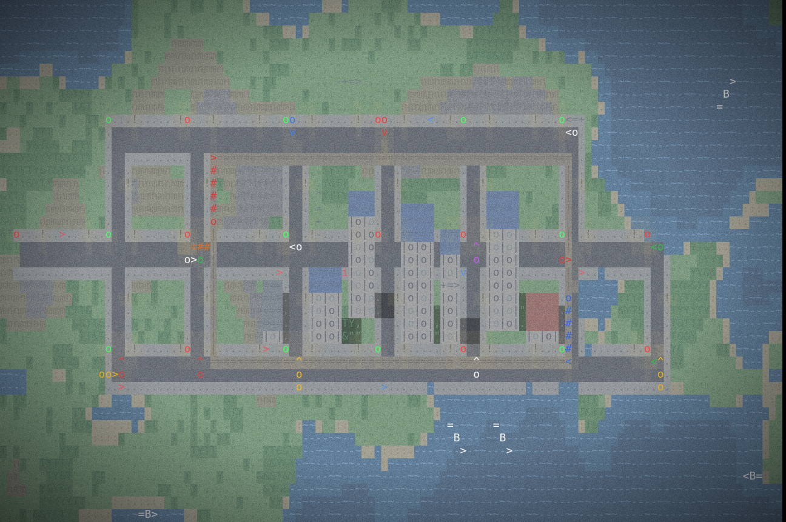
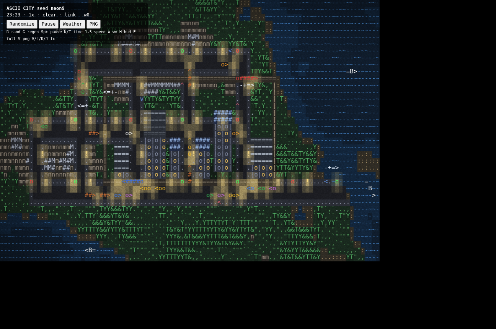
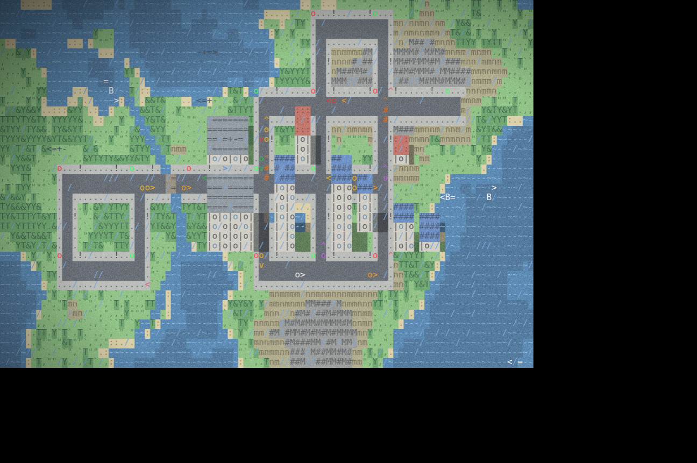

<div align="center">

# ASCII CITY



**A living city made of nothing but characters.**<br>
One HTML file · zero dependencies · works offline · runs anywhere.

[](https://developer.mozilla.org/en-US/docs/Web/HTML)
[](https://developer.mozilla.org/en-US/docs/Web/JavaScript)
[](index.html)
[](LICENSE)
[](index.html)

</div>

---

## What is it?

**ASCII CITY** is a generative art piece and a live desktop wallpaper engine hiding inside a single `index.html`. It builds an oblique city out of plain monospace glyphs, then animates it: cars queue at traffic lights, buses make stops, trains circle the rail loop, boats drift down the river, and planes cross the sky. The sun rises, the lamps flicker on, weather rolls in, and the whole scene can be frozen and exported as a wallpaper-ready PNG.

There is no build step, no framework, no server, and no network traffic. Download `index.html`, open it in a browser, and you are done.

| At a glance | |
| :--- | :--- |
| **Files** | 1 (`index.html`), plus docs & previews |
| **Dependencies** | 0 — vanilla HTML, CSS & JavaScript |
| **Size** | ~35 KB of source |
| **Rendering** | Canvas 2D + monospace characters |
| **Deterministic** | Same seed + settings = same city, every time |
| **Works offline** | Yes, including from `file://` |

---

## Features

- **♾️ Infinite, seedable cities** — a seeded PRNG plus layered value noise carves coastline, rivers, hills and building districts. Share a seed and anyone can regenerate your exact city.
- **🚗 Living road traffic** — cars, buses and trucks route through a real intersection graph using breadth-first distances, obey signals, queue behind each other and wait at bus stops.
- **🚆 Rail loop with stations** — trains run a loop around the city, dwell at stations and hand off to neighbouring screens.
- **⛵ Boats & ✈️ aircraft** — ferries patrol the water; both straight-line flyers and circling planes share the sky.
- **🚶 Pedestrians** — tiny walkers appear on sidewalks, more by day and fewer after dark.
- **🌗 Day / night cycle** — time advances automatically, with 19 hand-tuned colour palettes, animated street lamps, traffic lights and window glow.
- **🌦️ Six weather modes** — `auto`, `clear`, `rain`, `storm` (with lightning flashes), `snow` and `fog`, each with its own palette mix and particles.
- **🎞️ Cinematic effects** — optional film grain, scanlines, vignette and lamp bloom, all toggleable with one keystroke.
- **📸 One-key PNG export** — press <kbd>S</kbd>, or use `still=1` for a deterministic, fully rendered frame at any size — perfect for 4K wallpapers.
- **🖥️ Real live wallpaper** — recipes for X11 (`feh`, `swww`, `xwinwrap`), Wayland, macOS and Windows are in [`docs/WALLPAPER.md`](docs/WALLPAPER.md).
- **🪟 Multi-window / multi-monitor magic** — open one window per monitor and the cities find each other. They share the clock and weather, and vehicles actually drive, sail, fly and run across the seams.
- **🔗 URL params + persistence** — configure everything from the address bar; the seed and settings persist via `localStorage` and the seed is written back into the URL so it is always shareable.
- **⌨️ Tiny HUD, big control panel** — hidden by default; press <kbd>H</kbd> to reveal live status and buttons.
- **📦 Single file, no build** — no npm, no CDN, no tracking. It even works by double-clicking the file.

---

## Preview gallery

### Golden hour — seed `harbor7`


### Night shift — seed `neon9`, HUD enabled



### Storm front — seed `rainy4`



---

## Quick start

Just open the file:

```sh
# Linux
xdg-open index.html

# macOS
open index.html

# Windows
start index.html
```

Or double-click `index.html` in your file manager. That's the whole installation.

Want a shareable link? Enable **GitHub Pages** (see below) or drop the file on any static host — Netlify, Cloudflare Pages, Vercel, itch.io, a USB stick — it makes no difference.

### Publish it with GitHub Pages

1. Push this repository to GitHub.
2. Go to **Settings → Pages**.
3. Set **Build and deployment → Source** to **GitHub Actions** (the included [`.github/workflows/pages.yml`](.github/workflows/pages.yml) handles the rest) — or choose **Deploy from a branch → `main` / `/ (root)`** for a no-workflow setup.
4. Your city will be live at `https://<your-username>.github.io/<repo-name>/`.

---

## Controls

Press <kbd>H</kbd> to show the HUD. Modifier keys are ignored, so browser shortcuts keep working.

| Key | Action |
| :--- | :--- |
| <kbd>R</kbd> | New random seed (regenerates the city and syncs other windows) |
| <kbd>G</kbd> | Regenerate with the current seed |
| <kbd>Space</kbd> | Pause / resume the simulation |
| <kbd>N</kbd> | Jump forward 1 hour |
| <kbd>T</kbd> | Jump forward 12 hours |
| <kbd>1</kbd> – <kbd>5</kbd> | Speed: 0.25×, 0.5×, 1×, 2×, 4× |
| <kbd>W</kbd> | Cycle weather: auto → clear → rain → storm → snow → fog |
| <kbd>H</kbd> / <kbd>U</kbd> | Toggle the HUD |
| <kbd>F</kbd> | Toggle fullscreen |
| <kbd>S</kbd> | Save the current frame as `city-<seed>.png` |
| <kbd>V</kbd> | Toggle vignette |
| <kbd>L</kbd> | Toggle lights / night colouring |
| <kbd>K</kbd> | Toggle scanlines |
| <kbd>J</kbd> | Toggle film grain |

---

## URL parameters

Everything is configurable from the address bar. URL parameters take priority over saved settings. Append them with `?` and separate with `&`, for example:

```
index.html?seed=harbor7&hour=19&weather=storm&speed=2&font=18&ui=1
```

| Parameter | Example | Default | Description |
| :--- | :--- | :--- | :--- |
| `seed` | `harbor7` | random | Any short string. Same seed = same city. |
| `hour` | `19` | `10` | Starting time, `0`–`24` (wraps around). |
| `speed` | `2` | `1` | Simulation speed, `0.25`–`4`. |
| `weather` / `w` | `rain` | `auto` | `auto`, `clear`, `rain`, `storm`, `snow`, `fog`. |
| `traffic` | `1.5` | `1` | Vehicle density, `0`–`3`. |
| `people` | `2` | `1` | Pedestrian density, `0`–`3`. |
| `water` | `0.35` | `0.3` | Amount of water, `0.1`–`0.6`. |
| `built` | `0.8` | `0.6` | Initial building coverage, `0`–`1` (it grows over time). |
| `font` | `18` | `14` | Character cell size in pixels, `6`–`60`. |
| `cols`, `rows` | `200`, `60` | auto | Force the grid size and stretch to the viewport. |
| `modes` | `road,rail` | all | Comma-separated transport layers: `road`, `rail`, `water`, `air`, `foot`. |
| `ui` | `1` | off | Show the HUD on load. |
| `grain` | `0` | on | Film grain overlay. |
| `scanlines` | `1` | off | CRT scanline overlay. |
| `vignette` | `0` | on | Darkened edges. |
| `lights` | `0` | on | Street lamps and night palette. |
| `paused` | `1` | off | Start paused. |
| `still`, `animate=0` | `1` | off | Render one deterministic frame and stop (ideal for screenshots). |

Boolean parameters accept `1` / `0`, `true` / `false`, or can be supplied bare to enable. The seed and settings are stored under the `asciicity2` key in `localStorage`; press <kbd>R</kbd> to start over.

**Screenshot recipe**

```
index.html?seed=harbor7&still=1&ui=0&hour=17&font=18&grain=0
```

---

## Multiple windows, one city

This is the party trick. Open the same file in several windows — one per monitor — and give them all the same `seed`. Within about a second they discover each other using `BroadcastChannel` (with a `localStorage` fallback) and work out their relative positions from `screenX`, `screenY` and window size.

- The oldest window leads the shared clock and weather.
- Roads, railways, rivers and flight paths that reach a screen edge connect to the matching neighbour.
- Cars, buses, boats, planes and trains then **cross from one window into the next**, using gate positions to enter at a matching point.
- Press <kbd>H</kbd> to see linked sides, e.g. `link EW w0`.

See [`docs/WALLPAPER.md#multi-monitor-setup`](docs/WALLPAPER.md#multi-monitor-setup) for the exact window placement recipe.

---

## How it works

1. **Terrain** — a seeded hash + xorshift PRNG feeds two fractal noise fields. Elevation is histogram-normalised, so every seed produces a balanced mix of water, shore, sidewalk, park, hill and mountain.
2. **Infrastructure** — a grid of road nodes is laid out, validated against water and buildings, then connected with east/west and north/south edges. Breadth-first distance tables let vehicles route to a destination without pathfinding at runtime.
3. **Buildings** — blocks are filled with a depth/occlusion buffer so skyscrapers hide what is behind them, with lit windows based on time of day.
4. **Simulation** — vehicles are small state machines (parked, driving, stopped at a stop, crossing a border). Pedestrians random-walk on sidewalks; weather particles wrap around the grid.
5. **Rendering** — a character buffer and a z-buffer are rebuilt each frame, colour runs are batched into `fillRect` calls, and glyphs are drawn as text. Optional overlays add grain, scanlines and vignette.
6. **Linking** — peer windows exchange `hello`, `seed` and hand-off messages (`v` vehicles, `b` boats, `p` planes, `t` trains) with deduplication, so the same car never appears twice.

---

## Project structure

```
ascii-city/
├── index.html                     # the entire application
├── README.md                      # this file
├── LICENSE                        # MIT
├── CONTRIBUTING.md                # how to contribute
├── .gitignore
├── .github/
│   └── workflows/
│       └── pages.yml              # automatic GitHub Pages deploy
└── docs/
    ├── WALLPAPER.md               # desktop wallpaper recipes
    └── screenshots/
        ├── hero-dusk.png
        ├── night-hud.png
        └── storm.png
```

---

## Contributing

Bug reports, new seeds, palette ideas and wallpaper recipes are welcome — see [`CONTRIBUTING.md`](CONTRIBUTING.md). Please keep the project single-file and dependency-free.

---

## License

[MIT](LICENSE) — use it as a wallpaper, remix it, ship it, just keep the notice. Made for people who think text can be beautiful.
